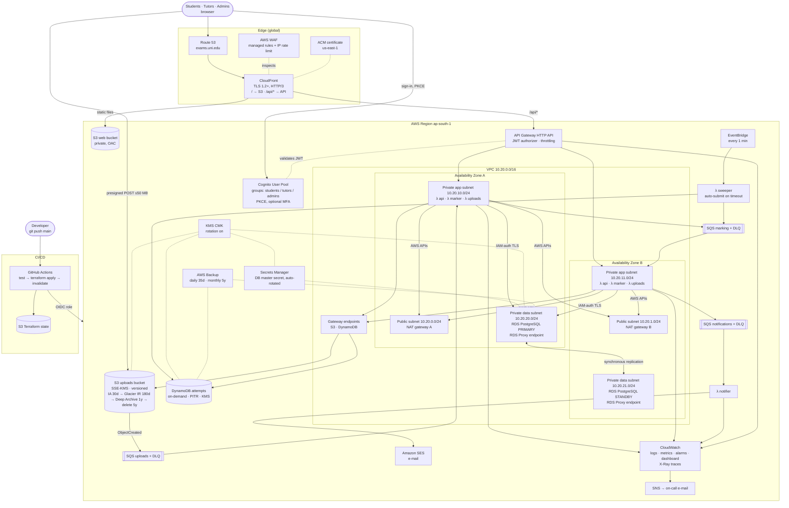

# Architecture – UniExam online exam & submission platform

Production design for 8,000 students and 400 staff. Every box below exists in [`infra/`](../infra) (Terraform). Region: `ap-south-1` (Mumbai) by default, configurable.

- Diagram source: [`diagram.mmd`](diagram.mmd) (Mermaid, renders on GitHub)
- Request walkthroughs: [`walkthroughs.md`](walkthroughs.md)
- Service-by-service justification: [`../docs/services.md`](../docs/services.md)

## 1. Diagram

> Rendering the diagram for submission: paste [`diagram.mmd`](diagram.mmd) into <https://mermaid.live> and export PNG/SVG to `architecture/diagram.png`. The Cloud Architecture Lab version goes in [`../evidence/`](../evidence).

## 2. Tiers

| Tier | Components | Placement |
|---|---|---|
| Edge | Route 53, ACM, CloudFront, WAF | Global (WAF/ACM in us-east-1) |
| Presentation | Static SPA in a private S3 bucket, served only through CloudFront (Origin Access Control) | Regional, multi-AZ by design |
| Identity | Cognito user pool, three groups, authorization-code + PKCE, 60-minute tokens, refresh tokens, optional TOTP MFA | Regional, managed |
| API / compute | API Gateway HTTP API (JWT authorizer, 1,000 rps / 2,000 burst throttle) → Lambda `api` (alias `live`, optional provisioned concurrency) | Lambda ENIs in **both** private app subnets |
| Async | SQS `marking`, `uploads`, `notifications` (+ DLQs); Lambdas `marker`, `uploads`, `notifier`; EventBridge → `sweeper` | Regional; VPC Lambdas in both AZs |
| Data | RDS PostgreSQL 16 **Multi-AZ** + RDS Proxy (exams, results, assignments, submissions); DynamoDB `attempts` (live exam state and autosaves); S3 `uploads` | Data subnets in both AZs have no internet route |
| Security | KMS CMK (RDS, DynamoDB, S3, secrets, backups), Secrets Manager, IAM role per function, SG chain Lambda → Proxy → DB, TLS enforced everywhere, VPC flow logs | — |
| Operations | CloudWatch logs/alarms/dashboard, X-Ray, SNS alerts, AWS Backup | — |
| Delivery | GitHub Actions with OIDC, Terraform, remote S3 state | — |

**Why two databases?** Autosave is a high-rate, single-key write (≈100 writes/s at peak), which suits DynamoDB on-demand: no connections, no capacity planning, and single-digit-ms latency. Exams, results, assignments and submissions are relational (joins, reports, release-results transactions), so they go in PostgreSQL. The marker Lambda moves a finished attempt from DynamoDB into PostgreSQL.

**Encryption.** In transit: CloudFront redirects to HTTPS; API Gateway, Cognito and SES are HTTPS-only; the uploads bucket policy denies requests without TLS; RDS Proxy `require_tls` is set and the database parameter group sets `rds.force_ssl=1`. At rest: the KMS CMK encrypts RDS, DynamoDB, the S3 uploads bucket, the DB secret and the backup vault; SQS uses SSE.

**Retention (5 years).** S3 lifecycle moves objects through the tiers above and expires them at 1,825 days. AWS Backup keeps monthly RDS and DynamoDB recovery points for 1,825 days. Results stay in PostgreSQL.

## 3. Exam peak and loss of an Availability Zone (≤300 words)

**Peak (3,000 students start one exam within 5 minutes).** The start spike is about 10 requests/s, and steady-state autosave is 3,000 ÷ 30 s ≈ 100 writes/s. CloudFront serves the static app from edge caches. Lambda scales per request, and `api_provisioned_concurrency` removes cold starts during exam week. The exam paper is cached in Lambda memory for 60 s, so 3,000 starts cost only a few database reads. Autosaves go to DynamoDB on-demand with a per-student partition key (`examId#studentId`), which has no hot partition and needs no database connections. RDS Proxy pools connections, so Lambda bursts cannot exhaust PostgreSQL. Submissions are queued on SQS and marked by at most 20 concurrent workers, so the end-of-exam surge waits in the queue instead of overloading the database. WAF's per-IP limit (20,000 requests per 5 minutes) is set high on purpose, because a whole campus can share one NAT IP. API Gateway throttling protects the backend.

**Loss of one AZ.** Every tier spans two AZs. CloudFront, Cognito, API Gateway, DynamoDB, S3, SQS and SES are multi-AZ managed services. VPC Lambdas have ENIs in both app subnets, and invocations move to the healthy AZ. Each AZ has its own NAT gateway and route table, so outbound traffic has no cross-AZ dependency. RDS Multi-AZ replicates synchronously, which means no committed data is lost, and it fails over automatically in about 60–120 s. RDS Proxy keeps client connections and reconnects to the new primary, and the client retries (`db.py` reconnects once). During failover the browser keeps answers in localStorage and retries autosave every 30 s.

**RPO and RTO.** The RPO is at most 30 s of typing, and DynamoDB/RDS point-in-time recovery covers corruption. The RTO is minutes for an AZ loss and under 1 hour for a PITR restore or a `terraform apply`.
