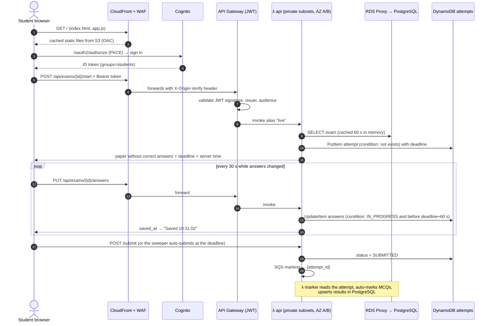
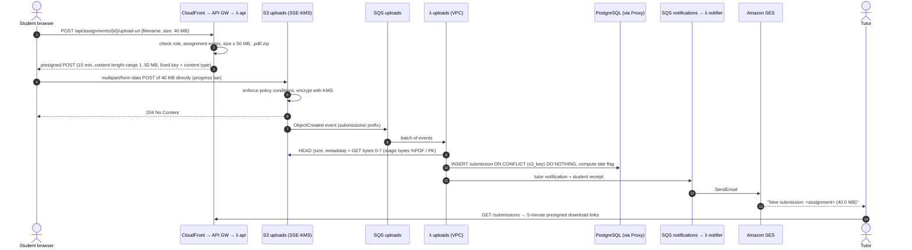

# Request walkthroughs

Each step names the real resource in `infra/` and the code in `backend/` or `frontend/` that handles it.

## Walkthrough 1 – A student opens an exam and answers autosave

1. **Load the app.** Route 53 resolves the domain to CloudFront. WAF checks the request against the managed rule groups and the per-IP rate limit, then CloudFront returns `index.html`, `app.js` and `config.js` from the private S3 web bucket through Origin Access Control.
2. **Sign in.** The SPA sends the student to the Cognito hosted login using authorization code + PKCE. Cognito returns an ID token whose `cognito:groups` claim contains `students`. Tokens last 60 minutes and the SPA refreshes them silently, so a 3-hour exam never logs the student out.
3. **Open the exam.** The browser calls `POST /api/exams/{id}/start`. CloudFront's `/api/*` behaviour (no caching) forwards the call to API Gateway and adds the secret `X-Origin-Verify` header. The JWT authorizer checks the token's signature, issuer and audience before Lambda runs.
4. **Lambda `api`** (ENIs in both private app subnets) checks the caller is in `students`. It loads the exam through RDS Proxy (IAM-token auth over TLS) or from its 60-second in-memory cache, and checks the exam window is open.
5. It writes the attempt to **DynamoDB** with `attribute_not_exists` and `deadline = min(start + duration, exam close)`. If the item already exists, the student is resuming (for example after a crash or an AZ failover), and the saved answers come back.
6. The response has the questions **without the correct answers**, the deadline, and the server time. The browser uses the server time to correct clock skew in the countdown.
7. **Autosave.** Every 30 s, and whenever the tab is hidden, the browser sends any changed answers with `PUT /answers`. Lambda validates them and calls a conditional `UpdateItem`: the write only succeeds while the attempt is `IN_PROGRESS` and the deadline (plus 60 s grace) has not passed, so the time limit is enforced on the server. Each keystroke is also written to `localStorage`, so a network drop loses nothing.
8. **Finish.** On submit, or automatically when the timer hits 0, the attempt becomes `SUBMITTED` and an `{attempt_id}` message goes to **SQS `marking`**. If the student just closes the laptop, the **sweeper** (EventBridge, every minute) finds expired `OPEN` attempts through a sparse GSI and submits them.
9. **Marking.** Lambda `marker` (at most 20 concurrent) reads the attempt, scores the MCQs, and upserts a row into `results` in PostgreSQL. It is idempotent, and messages that fail 5 times go to a DLQ, which triggers an alarm. Short answers wait for the tutor. When the tutor clicks **Release**, rows are marked released and one e-mail per student is queued on **SQS `notifications`**, which Lambda `notifier` sends through **SES**.

## Walkthrough 2 – A student uploads a 40 MB assignment and the tutor is notified

1. The student picks a 40 MB PDF. The browser checks size and type, then asks `POST /api/assignments/{id}/upload-url` (the same edge, auth and API path as Walkthrough 1).
2. Lambda `api` checks the caller is a student and the assignment exists. It cleans the filename and builds the key `submissions/<assignment>/<student-sub>/<uuid>-<file>`. It then returns an **S3 presigned POST** signed by its own role. The policy pins the key, the `Content-Type`, the student's e-mail metadata, and **`content-length-range` 1 B–50 MB**, so S3 itself rejects anything larger or anything sent to a different key. The URL expires after 15 minutes.
3. The browser uploads the 40 MB **directly to the regional S3 endpoint**, showing a progress bar. The file never passes through API Gateway (10 MB payload limit) or Lambda (6 MB), and transfer cost and time don't use compute. S3 encrypts the object with the KMS key, and the bucket policy rejects any request without TLS. The bucket CORS rule only allows the app's origin.
4. S3 sends an **ObjectCreated** event to **SQS `uploads`**. The queue policy only accepts events from this bucket.
5. Lambda `uploads` (VPC) reads the object's size and metadata and its first 8 bytes. A file whose content doesn't match `.pdf`/`.zip` is tagged `status=rejected`, and the student is e-mailed. Valid files are inserted into `submissions`, with `late` computed from `due_at`. `ON CONFLICT (s3_key) DO NOTHING` makes duplicate S3 events harmless.
6. Two messages go to **SQS `notifications`**: one to the tutor and one receipt to the student. Lambda `notifier` sends them with **SES**. Permanent failures, such as an unverified address while SES is in sandbox mode, are logged and not retried. Throttling is retried, and after 5 failed attempts the message goes to the DLQ, which triggers an alarm.
7. The tutor opens **Submissions** and gets 5-minute presigned download links. The object then moves to Standard-IA after 30 days, Glacier Instant Retrieval at 180 days, and Deep Archive at 1 year, and is deleted after 5 years.

## AZ-failure walkthrough (what happens if AZ A is lost mid-exam)

| t | Event | Effect on students |
|---|---|---|
| 0 s | AZ A loses power | Autosaves running in Lambda ENIs in AZ A fail; the browser marks them "Offline – retrying" and keeps answers in localStorage |
| 0–5 s | Lambda routes new invocations to the healthy subnet in AZ B | Next 30 s autosave succeeds; DynamoDB, S3, SQS and Cognito are unaffected |
| 0–120 s | RDS detects the primary failure and promotes the synchronous standby in AZ B; the DNS name stays the same; RDS Proxy reconnects | Exam start / results calls retry; autosave (DynamoDB) is not affected at all |
| ≤120 s | NAT gateway B still serves AZ B's route table | Outbound AWS API calls continue |
| after | RDS creates a new standby when AZ A returns | No action needed |

How to simulate it in AWS: `scripts/simulate-az-failover.sh` (forced RDS failover with `aws rds reboot-db-instance --force-failover`, while a load script keeps autosaving).
