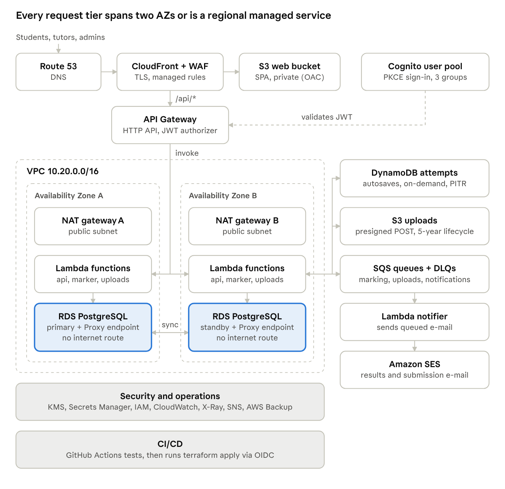
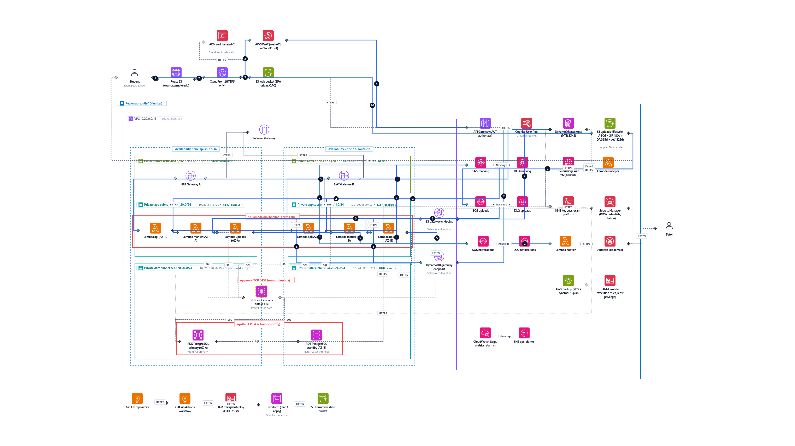
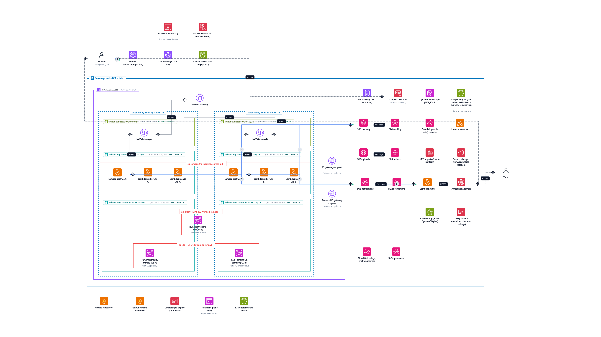

# Design and Implementation of a Highly Available Online Examination Platform on AWS

DSO303 Assignment 2 ·  19 November 2026

## Abstract

This report presents a serverless, two-Availability-Zone AWS architecture for a university online examination platform serving 8,000 students and 400 staff. The design targets 99.9% availability during exams, survival of a single Availability Zone (AZ) loss, a recovery point objective (RPO) of 5 minutes, a recovery time objective (RTO) of 1 hour, five-year record retention, and encryption in transit and at rest.

The solution combines a CloudFront and WAF edge, Cognito authentication, API Gateway with AWS Lambda compute, DynamoDB for high-frequency autosaves, a Multi-AZ RDS PostgreSQL database behind RDS Proxy, S3 with lifecycle tiering for submissions, and SQS-based asynchronous processing for marking and e-mail. The architecture was built and simulated in the Cloud Architecture Lab, including both request walkthroughs and an AZ failure. It is fully defined in Terraform and deployed through a GitHub Actions pipeline.

The report argues that separating the write-heavy autosave path from the relational system of record, and absorbing bursts with queues and on-demand services, allows the platform to meet the exam-week peak of 3,000 students starting within 5 minutes without over-provisioning for normal load.

## 1. Introduction

A university of 8,000 students and about 400 staff is moving all examinations and assignment submissions online. Students sit timed multiple-choice (MCQ) and short-answer exams and upload assignments. Tutors create exams, mark and release results, and administrators manage users and schedules.

An online exam has a sharper failure cost than most web applications. A five-minute outage during an exam can invalidate an assessment for thousands of students, and a lost answer is a lost mark. The platform must therefore be designed around its worst moment, the exam-week peak, rather than its average load.

The aims of this work are to:

1. Design a production architecture on AWS that meets the stated availability, recovery, retention and security targets (Task 1).
2. Justify each AWS service against a realistic alternative (Task 2).
3. Build and simulate the architecture in the Cloud Architecture Lab, and define it as reproducible infrastructure as code with an automated deployment pipeline (Task 3).

Section 2 analyses the requirements. Sections 3 to 5 present the architecture, the two request walkthroughs and the peak and failure analysis. Section 6 justifies the services, Section 7 describes the implementation, and Section 8 evaluates the design and its limitations.

## 2. Requirements analysis

The requirements fall into three groups: functional features, load characteristics and non-functional targets. The load profile is the most demanding of these, because it is highly bursty.

### 2.1 Functional requirements

- Role-based sign-in for students, tutors and administrators.
- Timed MCQ and short-answer exams, with answers autosaved every 30 seconds.
- Automatic marking of MCQs; tutors mark short answers and release results.
- Assignment uploads as PDF or ZIP files of up to 50 MB.
- E-mail to students when results are released, and to tutors when work is submitted.

### 2.2 Load characteristics

Normal load is 300 to 500 concurrent users. At exam-week peak, 3,000 students start one exam within 5 minutes, which is about 10 exam starts per second. Once the exam is running, each student autosaves every 30 seconds, giving a sustained rate of 3,000 ÷ 30 ≈ 100 writes per second. When the exam closes, up to 3,000 submissions arrive within a few minutes and must all be marked.

The ratio between peak and normal load, and the short duration of the peak, favour services that scale on demand over capacity provisioned for the worst case.

### 2.3 Non-functional targets and design response

| Target | Design response |
| --- | --- |
| 99.9% availability during exams | Managed regional services; all VPC compute and data in two AZs; no single instance on the request path |
| Survive loss of one AZ | Lambda ENIs, NAT gateways and RDS (Multi-AZ) in both AZs; per-AZ route tables |
| RPO ≤ 5 minutes | Autosave every 30 s to DynamoDB; synchronous RDS replication; point-in-time recovery on RDS and DynamoDB |
| RTO ≤ 1 hour | Automatic RDS failover (about 60–120 s); whole stack rebuildable with `terraform apply` |
| Retain records for 5 years | S3 lifecycle expiring at 1,825 days; AWS Backup monthly recovery points kept 1,825 days |
| Encryption in transit | HTTPS only at CloudFront, API Gateway and Cognito; S3 policy denies non-TLS; `rds.force_ssl = 1` |
| Encryption at rest | KMS customer-managed key for RDS, DynamoDB, S3, secrets and backups; SSE on SQS |

## 3. Architecture design

The platform is a serverless, event-driven architecture deployed in one AWS Region (ap-south-1, Mumbai) across two Availability Zones. Figure 1 shows how requests move through the tiers; the full build, with every component, is shown in the Cloud Architecture Lab image in Section 7.

*Figure 1. Requests enter through CloudFront and API Gateway and reach Lambda in either AZ; the Multi-AZ database pair (highlighted) is the only stateful component inside the VPC, and Lambdas reach DynamoDB and S3 through gateway endpoints.*

### 3.1 Network layout

The VPC uses the 10.20.0.0/16 range and has three subnet tiers in each of the two AZs:

| Tier | AZ A | AZ B | Contents | Internet route |
| --- | --- | --- | --- | --- |
| Public | 10.20.0.0/24 | 10.20.1.0/24 | NAT gateway (one per AZ) | Internet gateway |
| Private app | 10.20.10.0/24 | 10.20.11.0/24 | Lambda `api`, `marker`, `uploads` | Outbound only, via that AZ's NAT |
| Private data | 10.20.20.0/24 | 10.20.21.0/24 | RDS primary (A), standby (B), RDS Proxy | None |

Each AZ has its own app route table pointing at its own NAT gateway, so the loss of one AZ does not remove outbound access from the other. Gateway endpoints for S3 and DynamoDB keep the busiest traffic, autosaves and file reads, off the NAT and off the internet. Security groups form a chain: only the Lambda group can reach the proxy on port 5432, and only the proxy group can reach the database.

### 3.2 Tiers

- **Edge.** Route 53 resolves the domain to CloudFront, which terminates TLS with an ACM certificate. AWS WAF applies AWS managed rule groups and a per-IP rate limit. CloudFront serves `/` from a private S3 bucket through Origin Access Control and forwards `/api/*` to API Gateway.
- **Frontend.** A static single-page application in vanilla JavaScript. It keeps answers in `localStorage` as a local backup and corrects the countdown for clock skew using the server time.
- **Authentication.** A Cognito user pool with three groups (students, tutors, admins). Accounts are created by administrators only, and the browser signs in using the authorization code flow with PKCE.
- **API and compute.** An API Gateway HTTP API validates the Cognito JWT before any code runs, then invokes Lambda functions written in Python 3.13 on arm64. The functions run in both private app subnets and reject any request that did not come through CloudFront.
- **Data.** DynamoDB holds live exam attempts and autosaves. RDS PostgreSQL 16 (Multi-AZ), reached through RDS Proxy, holds exams, results, assignments and submission records. S3 holds uploaded files, with lifecycle rules moving them to Standard-IA after 30 days, Glacier Instant Retrieval after 180 days and Deep Archive after 365 days, and deleting them after 1,825 days.
- **Asynchronous processing.** Three SQS queues, `marking`, `uploads` and `notifications`, each with a dead-letter queue, feed worker Lambdas. An EventBridge rule runs a `sweeper` every minute to auto-submit attempts whose time has expired. E-mail is sent through Amazon SES.
- **Security.** One KMS customer-managed key encrypts data at rest. The database password is generated and rotated by RDS in Secrets Manager. Each Lambda has its own least-privilege IAM role.
- **Monitoring.** CloudWatch collects logs, metrics, alarms and a dashboard, X-Ray traces every Lambda, and SNS forwards alarms by e-mail. AWS Backup keeps daily recovery points for 35 days and monthly ones for five years.
- **CI/CD.** GitHub Actions tests the code, then runs `terraform apply` using a role assumed through OpenID Connect (OIDC), with state stored in a versioned S3 bucket.

### 3.3 Key design decision: two data stores

Autosave is a high-rate, single-key write of about 100 writes per second at peak. DynamoDB on-demand suits it: it needs no database connections or capacity planning, and responds in single-digit milliseconds. Exams, results, assignments and submissions are relational and need joins and transactions, such as releasing all results for an exam, so they belong in PostgreSQL. The `marker` function moves a finished attempt from DynamoDB into PostgreSQL. This keeps the write-heavy hot path away from the relational database at exactly the moment it is busiest.

## 4. Request walkthroughs

Both walkthroughs keep heavy or bursty work off the synchronous request path. Autosaves go straight to DynamoDB, file bodies go straight to S3, and marking and e-mail run asynchronously from queues.

### 4.1 A student opens an exam and answers autosave

1. **Load the app.** Route 53 resolves the domain to CloudFront. WAF inspects the request, and CloudFront returns the static files from the private S3 bucket.
2. **Sign in.** The browser is redirected to the Cognito hosted login using the authorization code flow with PKCE. Cognito returns a token whose group claim is `students`. Tokens last 60 minutes and are refreshed silently, so a long exam never logs the student out.
3. **Open the exam.** The browser calls `POST /api/exams/{id}/start`. CloudFront forwards the call to API Gateway and adds a secret origin header. The JWT authorizer checks the token's signature, issuer and audience before any Lambda runs.
4. **Start the attempt.** Lambda `api` checks that the caller is a student and that the exam window is open. It reads the exam through RDS Proxy, or from a 60-second in-memory cache, and writes an attempt to DynamoDB with a conditional write and a deadline. If the attempt already exists, for example after a browser crash or an AZ failover, the saved answers are returned and the student resumes.
5. **Return the paper.** The response contains the questions without the correct answers, the deadline and the server time.
6. **Autosave.** Every 30 seconds, and whenever the tab is hidden, the browser sends changed answers with `PUT /answers`. Lambda performs a conditional `UpdateItem` that succeeds only while the attempt is in progress and before the deadline plus 60 seconds of grace, so the time limit is enforced on the server. Every keystroke is also kept in `localStorage`.
7. **Submit and mark.** On submit, or when the timer reaches zero, the attempt is marked submitted and a message is placed on the `marking` queue. If the student simply closes the laptop, the `sweeper` finds the expired attempt and submits it. Lambda `marker` scores the MCQs and writes the result to PostgreSQL. When the tutor releases results, one e-mail per student is queued and sent through SES.

### 4.2 A student uploads a 40 MB assignment and the tutor is notified

1. **Request an upload URL.** The browser checks the file's size and type, then calls `POST /api/assignments/{id}/upload-url` through the same edge, authentication and API path as in 4.1.
2. **Issue a presigned POST.** Lambda `api` checks the caller's role and that the assignment exists, and builds a unique S3 key. It returns an S3 presigned POST that fixes the key and content type and allows only 1 byte to 50 MB. The URL expires after 15 minutes.
3. **Upload directly to S3.** The browser sends the 40 MB file straight to S3 with a progress bar. The file never passes through API Gateway, whose payload limit is 10 MB, or Lambda, whose limit is 6 MB. S3 encrypts the object with KMS, and the bucket policy rejects any request without TLS.
4. **Queue the event.** S3 sends an `ObjectCreated` event to the `uploads` queue.
5. **Validate and record.** Lambda `uploads` reads the object's size and its first bytes to confirm it really is a PDF (`%PDF`) or ZIP (`PK`). It records the submission in PostgreSQL and computes whether it is late. An `ON CONFLICT DO NOTHING` insert makes duplicate S3 events harmless.
6. **Notify.** Two messages are placed on the `notifications` queue, a notice to the tutor and a receipt to the student. Lambda `notifier` sends both through SES. Messages that fail five times go to a dead-letter queue, which raises an alarm.
7. **Download.** The tutor opens the submissions page and receives presigned download links that expire after 5 minutes.

## 5. Peak load and Availability Zone failure

The design absorbs the exam peak by scaling on demand and buffering bursts, and it survives an AZ loss because every component on the request path either spans two AZs or is a regional managed service.

### 5.1 Exam-week peak

- **Static content.** CloudFront serves the application from edge caches, so 3,000 page loads put almost no load on the origin.
- **Exam start.** Lambda scales per request. Provisioned concurrency on the `live` alias can remove cold starts during exam week. Because the exam paper is cached in Lambda memory for 60 seconds, 3,000 starts cost only a few database reads.
- **Autosave.** About 100 writes per second go to DynamoDB on-demand. The partition key combines exam and student (`examId#studentId`), so writes spread evenly with no hot partition, and no database connections are needed.
- **Database protection.** RDS Proxy pools connections, so a burst of Lambda invocations cannot exhaust PostgreSQL's connection limit.
- **End-of-exam surge.** Submissions are queued in SQS and marked by at most 20 concurrent workers. The surge waits in the queue instead of overloading the database, and an alarm fires if the backlog lasts more than 10 minutes.
- **Abuse protection.** API Gateway throttles at 1,000 requests per second with a burst of 2,000. WAF's per-IP rate limit is deliberately high, 20,000 requests per 5 minutes, because a whole campus may share one NAT IP address.

### 5.2 Loss of one Availability Zone

| Time after AZ A fails | What happens | Effect on students |
| --- | --- | --- |
| 0 s | Autosaves running in AZ A fail | The browser shows "Offline – retrying" and keeps answers in `localStorage` |
| 0–5 s | Lambda sends new invocations to the app subnet in AZ B | The next autosave succeeds; DynamoDB, S3, SQS and Cognito are unaffected |
| 0–120 s | RDS promotes the synchronous standby in AZ B; the endpoint name is unchanged and RDS Proxy reconnects | Exam starts and result calls retry; autosave is not affected because it uses DynamoDB |
| Throughout | NAT gateway B serves AZ B's route table | Outbound calls to AWS APIs continue |
| After recovery | RDS creates a new standby when AZ A returns | No action needed |

### 5.3 Recovery objectives

The worst-case data loss for a student is the last 30 seconds of typing, and even that is held in the browser and resent. This is well within the 5-minute RPO. Synchronous RDS replication means no committed database transaction is lost in an AZ failure. Point-in-time recovery on DynamoDB and RDS covers accidental deletion or corruption.

Recovery from an AZ loss takes minutes and needs no human action. A point-in-time restore, or a complete rebuild of the stack with `terraform apply`, fits within the 1-hour RTO.

## 6. Service selection and justification

Each service was chosen over a realistic alternative on the grounds of scaling behaviour, operational burden and cost at this workload. The full table, including configuration for every service, is in [`docs/services.md`](services.md); the main choices are summarised below.

| Service | Role | Chosen over | Reason |
| --- | --- | --- | --- |
| CloudFront | Single HTTPS entry point for static files and API | S3 website hosting; Application Load Balancer | Edge caching for 8,000 users, HTTPS only, one origin so no CORS; S3 website hosting is HTTP-only and public |
| AWS WAF | Layer-7 protection | Custom filtering in application code | AWS-maintained managed rules block bad traffic before it costs Lambda time |
| Cognito | Sign-in and role groups | Self-built password storage; Keycloak on EC2 | Managed OAuth2/OIDC with MFA; can federate to the university's identity provider later |
| API Gateway HTTP API | Authenticated API entry point | REST API; ALB | About 70% cheaper than REST API, lower latency, native JWT authorizer |
| AWS Lambda | All business logic and workers | EC2 or ECS with Auto Scaling | Scales from zero in seconds for a 5-minute spike; no idle cost between exam periods |
| RDS PostgreSQL Multi-AZ | System of record | Self-managed PostgreSQL on EC2; Aurora | Synchronous standby and automatic failover without running replication ourselves; lower minimum cost than Aurora at this size |
| RDS Proxy | Connection pooling | PgBouncer on EC2 | Managed and highly available; stops Lambda bursts exhausting connections; shortens failover |
| DynamoDB | Live attempts and autosaves | Writing autosaves to RDS; ElastiCache | 100 writes per second with no connections and on-demand scaling; ElastiCache is not durable |
| S3 (uploads) | Assignment files | EBS or EFS | Eleven nines of durability, presigned uploads bypass API limits, lifecycle tiers make 5-year retention cheap |
| SQS with DLQs | Buffering for marking, uploads and e-mail | SNS; Kinesis | Durable buffering with capped consumer concurrency; SNS has no back-pressure and Kinesis adds shard management |
| EventBridge + Lambda | Auto-submit expired attempts | Cron on an EC2 instance | No server to fail or patch |
| Amazon SES | Transactional e-mail | SNS e-mail; own SMTP server | Custom content and sender, high deliverability; SNS e-mail requires recipients to confirm subscriptions |
| KMS customer-managed key | Encryption at rest | AWS-owned keys | Auditable in CloudTrail, revocable, annual rotation |
| Secrets Manager | Database credentials | Password in configuration | Generated and rotated automatically; never seen by people or code |
| NAT gateway per AZ | Outbound access for private Lambdas | NAT instances; a single NAT | Managed; one per AZ removes a cross-AZ dependency |
| VPC gateway endpoints | Private path to S3 and DynamoDB | Routing through NAT | Free, and keeps the busiest traffic off the internet |
| CloudWatch, X-Ray, SNS | Logs, metrics, alarms, traces | Third-party APM | Native to every service used; no agents |
| AWS Backup | Five-year database backups | RDS automated backups alone | Automated backups are limited to 35 days |
| Terraform | Infrastructure as code | Console; CloudFormation | Reproducible from Git, plan before apply, manages the us-east-1 WAF in the same run |
| GitHub Actions | CI/CD | AWS CodePipeline | Lives with the code; keyless deployment through OIDC |

Two trade-offs deserve comment. Aurora Serverless v2 would scale the database more smoothly, but its minimum cost is higher, and because the design moves autosaves to DynamoDB, the relational load at peak is modest. RDS Proxy adds cost but is the main safeguard against connection exhaustion during a Lambda burst, so it is justified for exam weeks.

## 7. Implementation

The architecture was implemented in two ways: as a visual build in the Cloud Architecture Lab, where both walkthroughs and an AZ failure were simulated, and as code, with Terraform and a GitHub Actions pipeline.

### 7.1 Cloud Architecture Lab build

The complete design was built in the Cloud Architecture Lab (Figure 2), using the same names and CIDR ranges as the Terraform code so that the two correspond one to one. It contains the Region, the VPC, two AZs with public, app and data subnets, security groups, and all edge, data, asynchronous, security, monitoring and CI/CD components. Each scenario was saved as a JSON export in [`evidence/lab-json/`](../evidence/lab-json/), so the canvas can be reopened exactly.

*Figure 2. Full Cloud Architecture Lab build: Region, VPC, two AZs with three subnet tiers, edge, data, asynchronous, security, monitoring and CI/CD components.*

Three simulations were run:

1. **Simulation 1, exam and autosave**, traced the path from the student through Route 53, CloudFront and API Gateway to Lambda, RDS Proxy and DynamoDB, then on to marking and notification ([screenshot](../evidence/screenshots/lab-flow1-exam-autosave.png)).
2. **Simulation 2, 40 MB upload**, traced the presigned upload direct to S3, then the S3 event, the `uploads` queue and worker, the database record and the SES e-mail to the tutor ([screenshot](../evidence/screenshots/lab-flow2-upload-notify.png)).
3. **Simulation 3, AZ failure**, failed AZ A (NAT gateway A, the Lambdas in AZ A and the RDS primary). Traffic continued through the Lambdas and NAT gateway in AZ B, while the regional services were unaffected (Figure 3; [before](../evidence/screenshots/lab-az-failure-before.png)).

*Figure 3. Simulation 3 after AZ A is lost: traffic continues through the Lambdas and NAT gateway in AZ B.*

The lab also exposed a design flaw. Its validator raised a "VPC Ingress Violation: Direct Public Access to Private Subnet Blocked" warning on the RDS primary, because Secrets Manager and AWS Backup had been drawn as connecting into the database from outside the VPC. Both connections were reversed so that they originate from RDS, which matches how RDS-managed secrets and backups actually work. After the change, the only inbound path to the database is from RDS Proxy.

### 7.2 Infrastructure as code

The whole stack is defined in Terraform (AWS provider 6.x), split by concern: `network.tf`, `data.tf`, `storage.tf`, `auth.tf`, `compute.tf`, `async.tf`, `api.tf`, `edge.tf`, `monitoring.tf` and `backup.tf`. State is held in a versioned, encrypted S3 bucket with native locking. A separate bootstrap configuration creates the state bucket and the GitHub OIDC deployment role.

The application code is in Python. Pure business logic, such as validation, marking and upload-key handling, is kept in `core.py` and covered by 17 unit tests. A Terraform test suite plans the stack against mocked providers and asserts properties of each deployment profile, for example that the database is Multi-AZ and that every Lambda uses the expected IAM role.

### 7.3 CI/CD pipeline

On every push and pull request, GitHub Actions runs the unit tests, `terraform fmt`, `terraform validate` and the Terraform test suite. On a push to `main`, a second job builds the Lambda package, runs `terraform apply`, invalidates the CloudFront cache and calls `/api/health` as a smoke test. In production the job assumes an IAM role through OIDC, so no long-lived AWS keys are stored in GitHub.

### 7.4 Deployment in AWS Academy Learner Lab

AWS Academy Learner Lab was used as the deployment target because it is free to students, but it restricts IAM: new roles cannot be created, and session credentials expire after about four hours. Rather than fork the code, the Terraform exposes feature switches, and a `learner-lab.tfvars` profile applies the necessary substitutions:

| Production design | Learner Lab profile |
| --- | --- |
| One least-privilege role per Lambda | The pre-created `LabRole` |
| KMS customer-managed key | AWS-managed keys |
| RDS Proxy with IAM authentication | Direct TLS connection using the RDS-managed secret |
| WAF, AWS Backup, VPC flow logs | Disabled |
| E-mail through SES | E-mail content written to CloudWatch Logs |
| OIDC deployment role | Session keys stored as GitHub secrets |

The two-AZ VPC, RDS Multi-AZ, CloudFront, Cognito, API Gateway, Lambda, DynamoDB, S3 lifecycle rules, SQS with dead-letter queues and the pipeline are unchanged. The production design described in Sections 3 to 6 therefore remains the reference architecture, and the lab profile is a documented, reversible subset of it.

## 8. Evaluation, limitations and future work

The design meets each stated target on paper, and the AZ-failure behaviour was demonstrated in simulation. Several limitations remain.

### 8.1 Evaluation against the targets

- **Availability and AZ loss.** No component on the exam path depends on a single AZ. The main residual risk is the 60–120 seconds of RDS failover, during which exam starts and result queries retry. Autosave is unaffected because it uses DynamoDB.
- **Peak load.** The arithmetic in Section 2.2 (10 starts and 100 autosaves per second) is well within the default limits of Lambda, API Gateway and DynamoDB on-demand. Queues bound the database load at the end of an exam.
- **RPO and RTO.** The effective RPO is 30 seconds or less, against a target of 5 minutes, and AZ recovery is automatic. Restoring from backup or rebuilding with Terraform fits the 1-hour RTO.
- **Security.** Data is encrypted in transit and at rest; the database has no route to or from the internet; credentials are never stored in code; and the API rejects requests that bypass CloudFront.

### 8.2 Limitations

- **No load test.** The peak figures are calculated, not measured. A load test of 3,000 simulated students would be needed to confirm latency and throttling behaviour.
- **Single Region.** The design survives the loss of an AZ but not of the whole Region. This is a deliberate cost decision, since the brief requires AZ resilience only.
- **Lab profile differences.** The Learner Lab deployment omits RDS Proxy, WAF, AWS Backup and SES, and uses one shared IAM role. Its session keys must be refreshed in GitHub each session, which is less secure and less automated than OIDC.
- **Short-answer marking.** Only MCQs are auto-marked; short answers depend on tutors.
- **Exam integrity.** The platform enforces time limits on the server but does not address proctoring or plagiarism.

### 8.3 Future work

- Run a load test with a tool such as k6 or Distributed Load Testing on AWS before the first exam week.
- Federate Cognito with the university's identity provider through SAML, so students use their existing accounts.
- Add a warm standby in a second Region for disaster recovery, using DynamoDB global tables and RDS cross-Region snapshots.
- Add malware scanning of uploads, for example with Amazon GuardDuty Malware Protection for S3.

## 9. Conclusion

This report presented a serverless, two-AZ AWS architecture for an online examination platform for 8,000 students. Its central decision is to separate the high-rate autosave path, handled by DynamoDB, from the relational system of record, handled by RDS PostgreSQL Multi-AZ, and to move marking and e-mail onto queues. Together, these let the platform absorb the exam-week peak without being provisioned for it, and keep students working through the loss of an Availability Zone.

The design was built and simulated in the Cloud Architecture Lab, where the AZ-failure simulation behaved as intended and the lab's validator helped correct a flaw in the database's network exposure. The same architecture is fully defined in Terraform and deployed by a GitHub Actions pipeline, with a documented profile for AWS Academy Learner Lab. The main remaining step before production use would be a load test that confirms the peak calculations.

## References

Amazon Web Services (2024) *AWS Well-Architected Framework: Reliability Pillar*. Available at: https://docs.aws.amazon.com/wellarchitected/latest/reliability-pillar/welcome.html

Amazon Web Services (2024) *Amazon RDS Multi-AZ deployments*. Available at: https://docs.aws.amazon.com/AmazonRDS/latest/UserGuide/Concepts.MultiAZ.html

Amazon Web Services (2024) *Using Amazon RDS Proxy*. Available at: https://docs.aws.amazon.com/AmazonRDS/latest/UserGuide/rds-proxy.html

Amazon Web Services (2024) *Amazon DynamoDB on-demand capacity mode*. Available at: https://docs.aws.amazon.com/amazondynamodb/latest/developerguide/on-demand-capacity-mode.html

Amazon Web Services (2024) *Uploading objects using presigned URLs*. Available at: https://docs.aws.amazon.com/AmazonS3/latest/userguide/PresignedUrlUploadObject.html

Amazon Web Services (2024) *Using AWS Lambda with Amazon SQS*. Available at: https://docs.aws.amazon.com/lambda/latest/dg/with-sqs.html

Amazon Web Services (2024) *Managing the lifecycle of objects (Amazon S3)*. Available at: https://docs.aws.amazon.com/AmazonS3/latest/userguide/object-lifecycle-mgmt.html

HashiCorp (2024) *Terraform AWS Provider documentation*. Available at: https://registry.terraform.io/providers/hashicorp/aws/latest/docs

GitHub (2024) *Configuring OpenID Connect in Amazon Web Services*. Available at: https://docs.github.com/en/actions/security-for-github-actions/security-hardening-your-deployments/configuring-openid-connect-in-amazon-web-services
